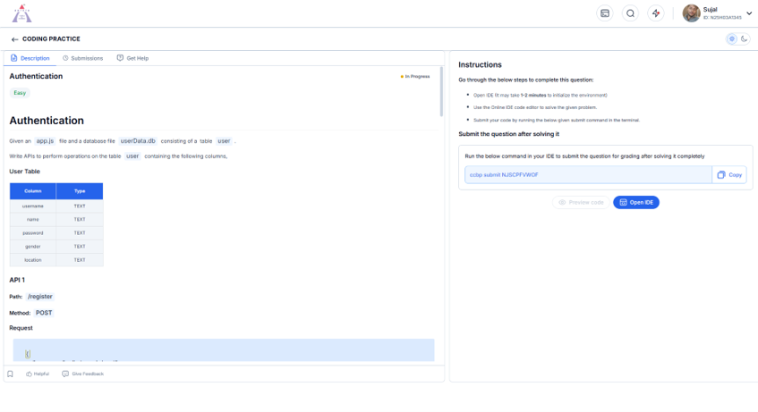
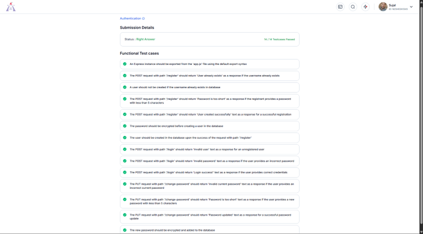
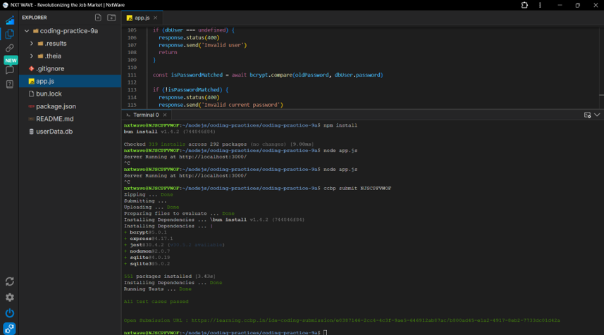

# Backend Development Fundamentals - Lab 4

## User Authentication System

This project implements a User Authentication System using Node.js, Express.js and SQLite. It provides APIs for user registration, login and password changing.

## Technologies Used

- Node.js
- Express.js
- SQLite
- SQLite3
- Bcrypt

## API Endpoints

| Method | Endpoint | Description |
|--------|----------|-------------|
| POST | /register | Register a new user |
| POST | /login | Login an existing user |
| PUT | /change-password | Change user password |

## Project Structure

```text
Backend Lab 4/
├── app.js
├── package.json
├── package-lock.json
├── .gitignore
└── screenshots/
    ├── question.png
    ├── test-cases.png
    └── output.png
```

## Screenshots

### 1. Question


### 2. Test Cases


### 3. Output


## How to Run

1. Clone this repository.
2. Install dependencies:

   ```bash
   npm install
   ```

3. Start the server:

   ```bash
   npm start
   ```

4. Server runs at `http://localhost:3000/`.

## Author

**Sujal Sharma**

**252U1R9152**

**CSE GEN AI 2-C (112)**

Backend Development Fundamentals Laboratory  
Department of Computer Science (Gen AI)
